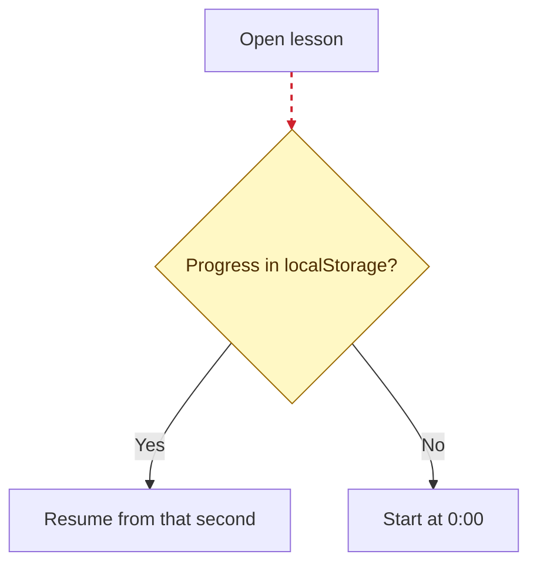
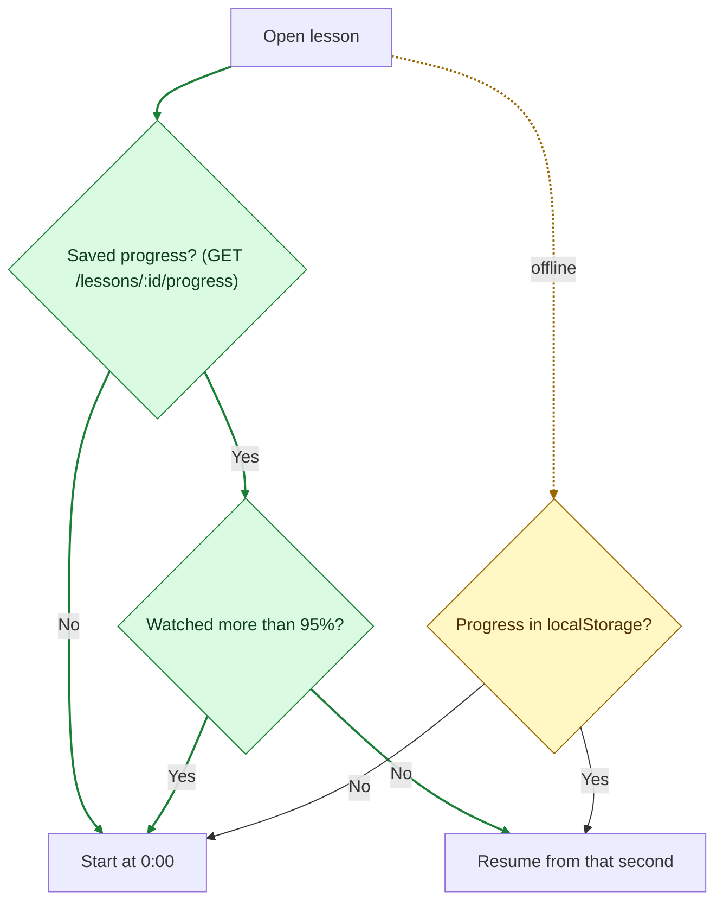
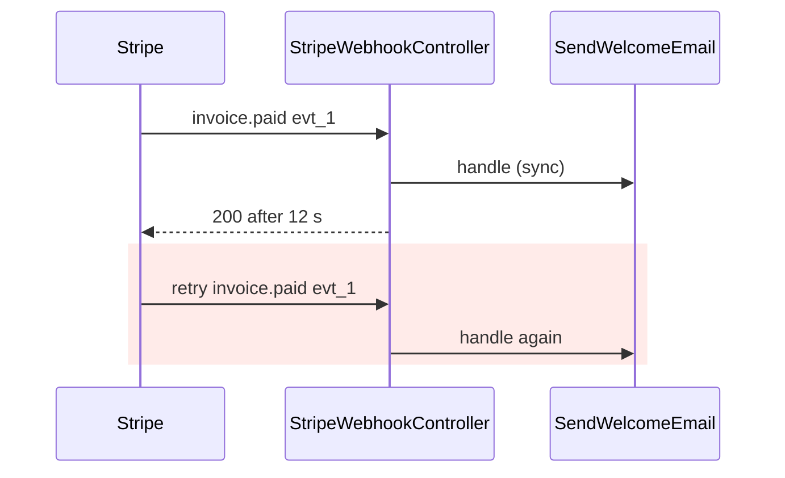
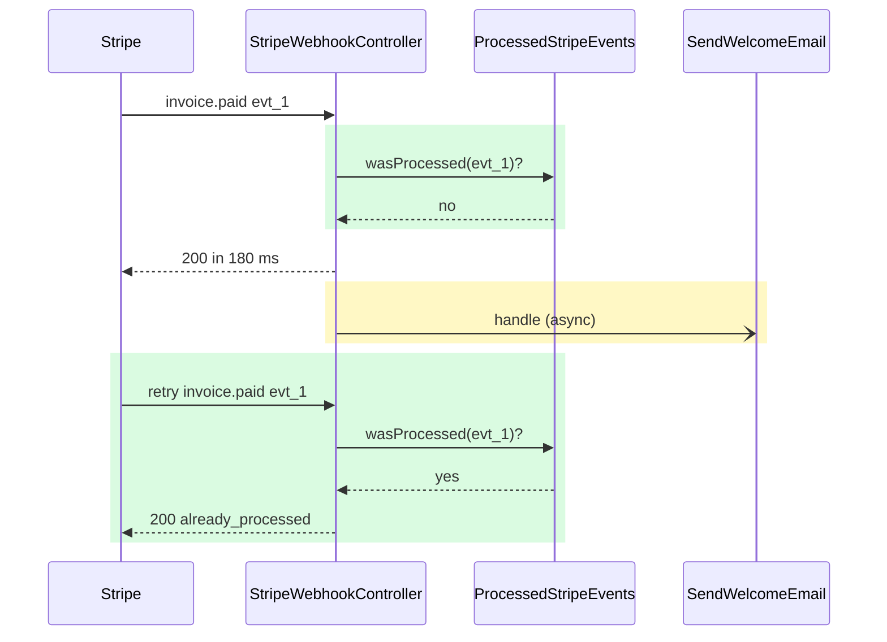
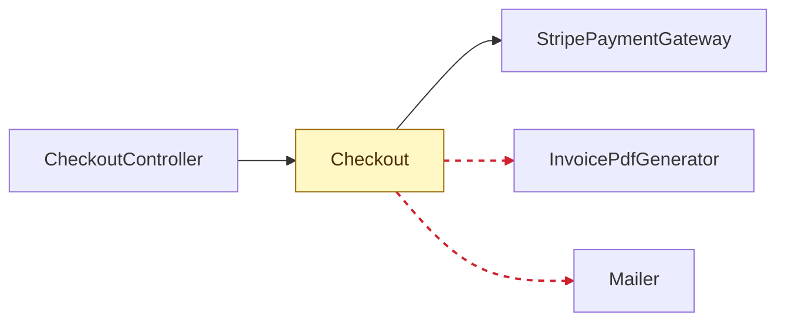
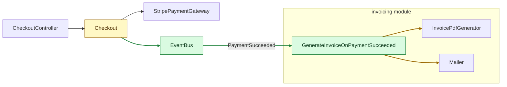

# Architecture diagrams

Write the diagrams in Mermaid code blocks in the body. GitHub and GitLab render them, so they need no upload.

## Layout in the body

Write the legend line once, above the first pair:

```markdown
### Architecture: who waits for whom

The webhook now checks the event id first and no longer waits for the email.

🟩 added · 🟥 removed (only in Before) · 🟨 changed

**Before**

(Mermaid block)

**After**

(Mermaid block)
```

- Put Before above After. Mermaid does not render inside a table.
- Use the same node IDs and the same labels on both sides, so the reviewer sees what moved.
- Write the sentence above the pair in plain words: what the reviewer must notice.
- For a new flow with no "before", write only After, with all of it marked as added.

## Colors

### Flowcharts

Declare only the classes that the diagram uses:

```text
classDef added fill:#dafbe1,stroke:#1a7f37,color:#0f3d1e
classDef removed fill:#ffebe9,stroke:#cf222e,stroke-dasharray:5 5,color:#82071e
classDef changed fill:#fff8c5,stroke:#9a6700,color:#4d2d00
```

Color the edges with `linkStyle`. The index of an edge is its position in the diagram, from 0, in the order you write the edges:

```text
linkStyle 0,1 stroke:#1a7f37,stroke-width:2px
linkStyle 2 stroke:#cf222e,stroke-width:2px,stroke-dasharray:5 5
linkStyle 3 stroke:#9a6700,stroke-width:2px
```

### Sequence diagrams

Sequence diagrams have no classes. Wrap the messages in a colored `rect`:

```text
rect rgb(218, 251, 225)   added
rect rgb(255, 235, 233)   removed (Before only)
rect rgb(255, 248, 197)   changed
```

## Pick the diagram

| The change is about…                         | Diagram           |
| -------------------------------------------- | ----------------- |
| A decision or a routing flow                 | `flowchart TD`    |
| The order of messages between components     | `sequenceDiagram` |
| The structure or the dependencies of modules | `flowchart LR`    |

A pull request can have several pairs, of different types. Draw one pair for each affected flow.

## Examples

### Decision: `flowchart TD`

The lesson player now reads the progress from the API, and `localStorage` is only the offline fallback.

**Before**



**After**



### Order of messages: `sequenceDiagram`

The Stripe webhook now ignores a repeated event and no longer waits for the welcome email.

**Before**



**After**



### Dependencies: `flowchart LR`

`Checkout` no longer calls the invoicing services. A new module listens to `PaymentSucceeded`.

**Before**



**After**



## Check the diagrams

- Put a label in double quotes if it has parentheses, slashes, colons or other special characters: `E{"Saved progress? (GET /lessons/:id/progress)"}`.
- If `npx` is available, render each diagram before you publish it: `npx -y @mermaid-js/mermaid-cli -i diagram.mmd -o "$TMPDIR/diagram.svg"`. A syntax error stops the command.
- After you create or edit the pull request, open it and make sure that each diagram renders.
